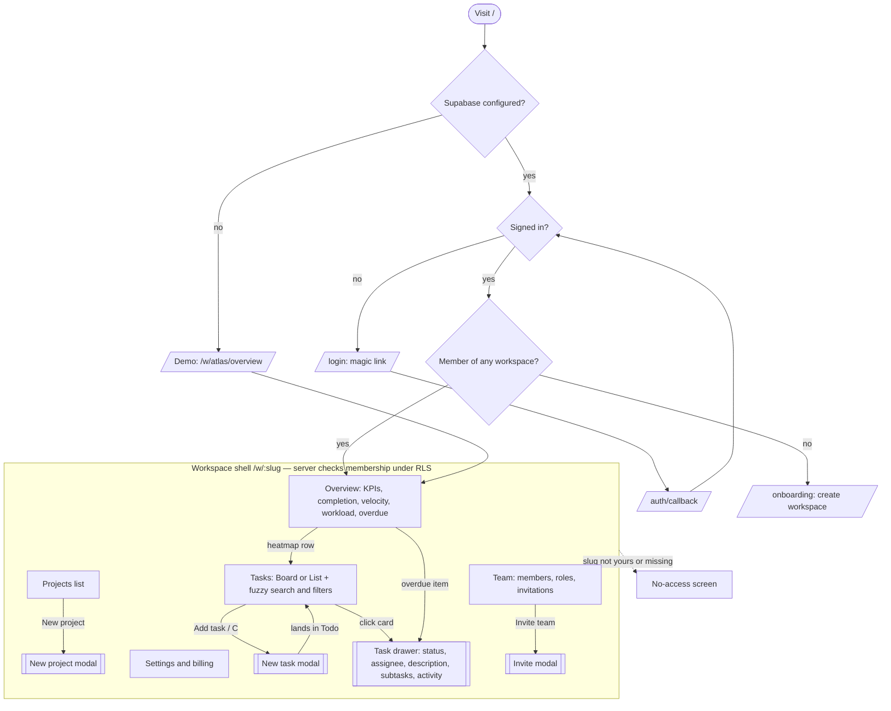

# Flows — Keel

Sitemap and critical journeys (`PRD.md` §2). The diagram lives in the repo
as Mermaid, which GitHub renders, instead of in a separate FigJam file.

## Journey paths

| Journey | Normal | Failure | Permission denied | Empty | Recovery |
|---|---|---|---|---|---|
| J1 create and move a task | Modal → Todo → drag → saved and synced | Card snaps back, toast explains | Non-member write rejected by RLS | "No tasks yet" and one create action | Retry from the toast; server state wins |
| J2 switch workspace | Switcher lists only your workspaces | Load error with Retry | Typed URL → no-access screen | No workspaces → onboarding | Switcher / "Back to your workspaces" |
| J3 edit in the drawer | Each field saves on change | Field rolls back, toast | Same as J1 | "No activity yet" | Retry from the toast |
| J4 invite a teammate | Admin records invite | Validation or conflict message | Member sees who can invite; DB rejects anyway | "No pending invitations" | Revoke and re-invite |
